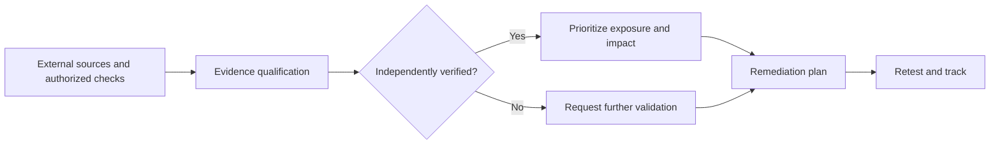

# Field study | External exposure and vulnerability assessment

**SOC CORE · Security Engineering · Anonymized field study**

> **Anonymized field study.** This page summarizes lessons from an authorized external assessment at the risk-category level only. It contains no customer name, target domains, IP addresses, URLs, hostnames, specific ports, service versions, screenshots, asset counts, raw evidence or customer records.

## Objective

Review an organization's internet-facing exposure, separate independently verified observations from third-party risk signals, and translate technical evidence into prioritized, actionable risk-reduction recommendations.

This study illustrates a **SOC CORE-aligned security engineering workflow** combining exposure intelligence, scoped non-intrusive checks, evidence qualification, prioritization and executive reporting. **It does not claim that every assessment activity was executed automatically by SOC CORE.**

## Assessment workflow

1. **External surface review:** analyze public information and exposure signals supplied by a specialized third-party assessment platform.
2. **Scoped service checks:** perform authorized connectivity and high-level service-identification checks, without authentication or exploitation.
3. **DNS and email control validation:** inspect public policies and test SPF evaluation without sending email.
4. **Evidence qualification:** distinguish reproduced technical observations from third-party signals requiring independent verification.
5. **Risk treatment:** recommend actions based on potential impact, control ownership and verification needs.

## Observations and improvement opportunities

| Area | Evidence status | Improvement opportunity |
|---|---|---|
| Internet-facing service exposure | **Confirmed through authorized non-intrusive checks:** an exposure warranted additional review; implementation and fingerprint details are intentionally omitted. | Review the need for public exposure; apply appropriate network restrictions, segmentation and approved access controls. |
| Email authentication policy hygiene | **Confirmed through authorized DNS-based checks:** policy complexity warranted follow-up; the precise configuration and validation results are intentionally omitted. | Simplify policy dependencies, validate authorized senders and monitor authentication outcomes. |
| HTTPS and web security headers | **Third-party assessment signals; independent confirmation pending.** | Verify HTTPS enforcement, HSTS, CSP and relevant browser security headers before remediation. |
| TLS configuration and certificates | **Third-party assessment signals; independent confirmation pending.** | Review supported protocols/ciphers, certificate validity and renewal processes. |
| Web resource integrity and information exposure | **Third-party assessment signals; independent confirmation pending.** | Assess SRI configuration, error handling, visible application logs and unnecessary technical disclosure. |
| Component lifecycle and credential-related indicators | **Third-party indicators; no compromise confirmed.** | Validate applicability, inventory and version evidence; review credentials only when supported by reliable evidence and authorization. |

**Evidence caveat:** network reachability does not establish unauthorized access; a vulnerability or credential alert does not prove exploitability, data exposure or compromise. No password attempts, exploitation or data-access tests were performed.

## Prioritization workflow

**High priority:** review unnecessarily exposed services and independently confirmed high-impact exposure categories.

**Medium priority:** address validated configuration defects and review HTTPS, TLS and email-authentication controls.

**Validation-dependent priority:** investigate third-party alerts before presenting them as confirmed vulnerabilities or introducing disruptive changes.

## Engineering outputs

- Findings categorized by source and confidence level.
- Exposure-reduction and security-hardening recommendations.
- Remediation priorities that distinguish observed risk from unconfirmed hypotheses.
- Technical and executive reporting built around ownership, next actions and retesting.

## Scope and disclosure limits

This activity was not a full penetration test, compliance audit or demonstration of exploitation. Publication requires an explicit confidentiality and indirect-identification review before merging. Findings depend on authorized scope, point-in-time reachability and source quality. Potentially identifying context has been deliberately excluded. **No raw scan output or customer assessment report is published in this repository.**

[Back to SOC CORE documentation](../../README.md) · [Português (Brasil)](external-exposure-assessment.pt-BR.md)
