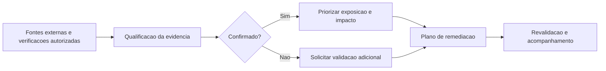

# Estudo de caso | Avaliação externa de exposição e vulnerabilidades

**SOC CORE · Engenharia de Segurança · Estudo de caso anonimizado**

> **Estudo de caso anonimizado.** Esta publicação descreve lições de uma avaliação externa autorizada, em nível de categorias de risco. Não contém nome do ambiente avaliado, domínios, endereços IP, URLs, hostnames, portas específicas, versões, capturas de tela, volumes de ativos, evidências brutas ou dados de clientes.

## Objetivo

Avaliar a superfície externa de um ambiente corporativo, distinguir evidências tecnicamente verificadas de indicações reportadas por fontes externas e transformar observações em recomendações priorizadas de redução de risco.

O trabalho ilustra um **fluxo de engenharia de segurança associado ao SOC CORE**: coleta e análise de sinais de exposição, verificações autorizadas e não intrusivas, qualificação de evidências, priorização e comunicação executiva. **Não significa que todas as verificações foram executadas automaticamente pela plataforma.**

## Abordagem de avaliação

1. **Reconhecimento de superfície externa:** revisão de informações públicas e alertas de exposição disponibilizados por plataforma especializada.
2. **Verificação delimitada de serviços:** checagem ativa de conectividade e identificação superficial de serviço em alvos autorizados, sem autenticação ou exploração.
3. **Validação de controles DNS e e-mail:** análise técnica das políticas públicas e teste de avaliação SPF sem envio de mensagens.
4. **Qualificação de evidências:** separação entre observações reproduzidas e alertas de terceiros que ainda requerem confirmação.
5. **Gestão de riscos:** organização de recomendações por criticidade potencial, facilidade de correção e necessidade de validação pelo proprietário do ativo.

## Observações e oportunidades de melhoria

| Área | Situação da evidência | Oportunidade de melhoria |
|---|---|---|
| Exposição de serviços na internet | **Confirmado em verificações autorizadas e não intrusivas:** uma exposição exigiu análise complementar; detalhes de implementação e identificação foram omitidos. | Revisar a necessidade de exposição pública; adotar restrições de rede, segmentação e controles autorizados de acesso. |
| Higiene das políticas de autenticação de e-mail | **Confirmado por verificações autorizadas de DNS:** a complexidade da política exigiu revisão; a configuração e os resultados exatos foram omitidos. | Simplificar dependências, validar remetentes autorizados e monitorar resultados de autenticação. |
| HTTPS e cabeçalhos de segurança | **Sinais de ferramenta externa; confirmação adicional necessária.** | Validar redirecionamento HTTPS, HSTS, CSP e cabeçalhos de proteção; ajustar com testes de compatibilidade. |
| TLS e certificados digitais | **Sinais de ferramenta externa; confirmação adicional necessária.** | Revisar protocolos e cifras permitidos, validade dos certificados e política de renovação. |
| Integridade de recursos web e exposição de informações | **Sinais de ferramenta externa; confirmação adicional necessária.** | Revisar SRI, tratamento de erros, logs visíveis em páginas e informações técnicas desnecessariamente expostas. |
| Atualização de componentes e credenciais | **Indicadores reportados por fonte externa, não comprovação de comprometimento.** | Verificar aplicabilidade das recomendações, inventário e versões; acionar revisão de credenciais somente quando houver evidências confiáveis e autorização. |

**Interpretação:** um serviço alcançável não demonstra acesso indevido; um alerta de vulnerabilidade ou de credencial não prova exploração, vazamento ou comprometimento. Não foram realizados testes de senha, exploração de falhas nem tentativa de acesso a dados.

## Fluxo de priorização

**Prioridade alta:** revisar exposição desnecessária de serviços e categorias de risco de alto impacto confirmadas de forma independente.

**Prioridade média:** corrigir falhas verificadas de configuração e avaliar ajustes em HTTPS, TLS e políticas de e-mail.

**Prioridade condicionada à validação:** investigar alertas externos antes de registrar uma vulnerabilidade como confirmada ou exigir mudanças potencialmente disruptivas.

## Entregáveis de engenharia

- Registro de achados com origem e nível de confiança.
- Recomendações de redução de superfície de ataque e hardening.
- Priorização de correções com distinção entre risco observado e hipótese pendente.
- Comunicação técnica e executiva orientada a responsáveis, providências e revalidação.

## Limites e confidencialidade

Esta avaliação não constitui teste de intrusão completo, auditoria de conformidade ou comprovação de exploração. A publicação depende de revisão explícita de confidencialidade e possibilidade de identificação indireta antes da integração. Os resultados dependem do escopo autorizado, da disponibilidade dos serviços no momento do teste e da qualidade das fontes. Detalhes que permitam reconhecer o ambiente foram deliberadamente omitidos. **Nenhum artefato bruto de varredura ou relatório do cliente é disponibilizado neste repositório.**

[Voltar à documentação do SOC CORE](../../README.pt-BR.md) · [English version](external-exposure-assessment.md)
