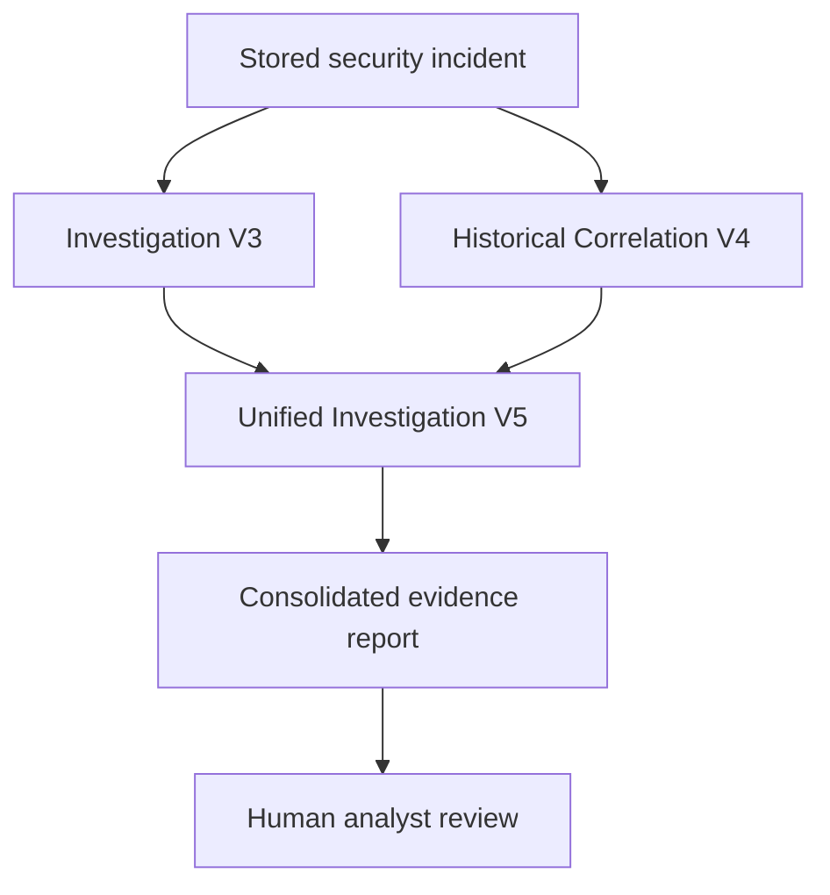

# SOC CORE — SOAR Investigation Engine (V1–V5)

**Status:** manual proof of concept validated in an authorized environment  
**Update:** 2026-10-19  
**Scope:** public, sanitized engineering documentation — no production source code or customer-specific details

## Objective

Evolve SOC CORE incident processing into a modular Security Orchestration, Automation and Response (SOAR) investigation workflow. This initial implementation **enriches and correlates evidence for analyst review**; it does **not** autonomously contain endpoints, submit block indicators, or create incident-management tickets.

## Iterations and validated behavior

| Stage | Capability | Validation |
| --- | --- | --- |
| Architecture assessment | Mapped existing event ingestion, database, AI-analysis and ticketing components | Completed, read-only |
| Investigation V1 | Retrieve a stored incident and create a descriptive JSON investigation report | Validated |
| Investigation V2 | Reuse an existing, approved classifier for a supported event family; retain human review for unsupported rules | Validated in two contrasting cases |
| Investigation V3 | Extract normalized network fields, falling back to original event JSON; preserve detection signatures, event count and internal-address context | Validated |
| Correlation V4 | Retrieve historically related records and highlight *possible* security-scanner context | Validated; correlations are hypotheses, not proof |
| Unified Investigation V5 | Orchestrate V3 and V4 and generate one consolidated report | Validated for both test scenarios |

## Investigation workflow

## Validation approach

Two historical cases were used:

1. **Previously approved legitimate activity:** the dedicated classifier correctly identified an authorized event; V3 retained the suppression recommendation. V5 currently defaults to human review, rather than automatically enforcing that recommendation.
2. **Unverified network exploit signature:** V3 recovered network context and preserved a human-review recommendation. V4 found related events and flagged potential authorized scanner activity, **without declaring the detection benign or the exploit successful**. V5 consolidated the evidence and required human review.

Event counts describe grouped observations and must not be equated with distinct attacks. Time normalization uses the source-event timestamp when available; database creation time can differ. Network signature matches are not, by themselves, evidence of successful compromise.

## Safety boundaries

- New V1–V5 investigation modules were installed and tested **outside the production incident pipeline**.
- Testing did not modify the main application, scanner schedules, existing response services, or incident-management integrations.
- Investigations were manually invoked against historical records.
- The unified V5 recommendation is **mandatory human review**; it does not automatically block IPs, isolate endpoints, or create tickets.
- Existing production Active Response functionality is separate and is not disabled or replaced by the experimental investigation engine.
- Potential scanner activity must be corroborated using authorized job execution evidence, rather than allowing all traffic from a known security host.

## Next engineering milestones

1. Preserve approved classifications and their provenance in unified output while keeping enforcement disabled.
2. Validate correlation against unrelated incidents, including negative test cases and timestamp differences.
3. Introduce IOC enrichment with caching, quota control, evidence provenance and private-address exclusions.
4. Add unit tests, performance limits, deterministic reporting and structured audit events.
5. Only after formal review, integrate automatic **investigation/report generation** into production; treat containment and ticket creation as separately approved workflows.

## Repository boundary

This repository intentionally excludes internal IP addresses, customer identifiers, incident IDs, report payloads, production code, credentials and private infrastructure configurations. The live implementation remains in the authorized operational environment.
