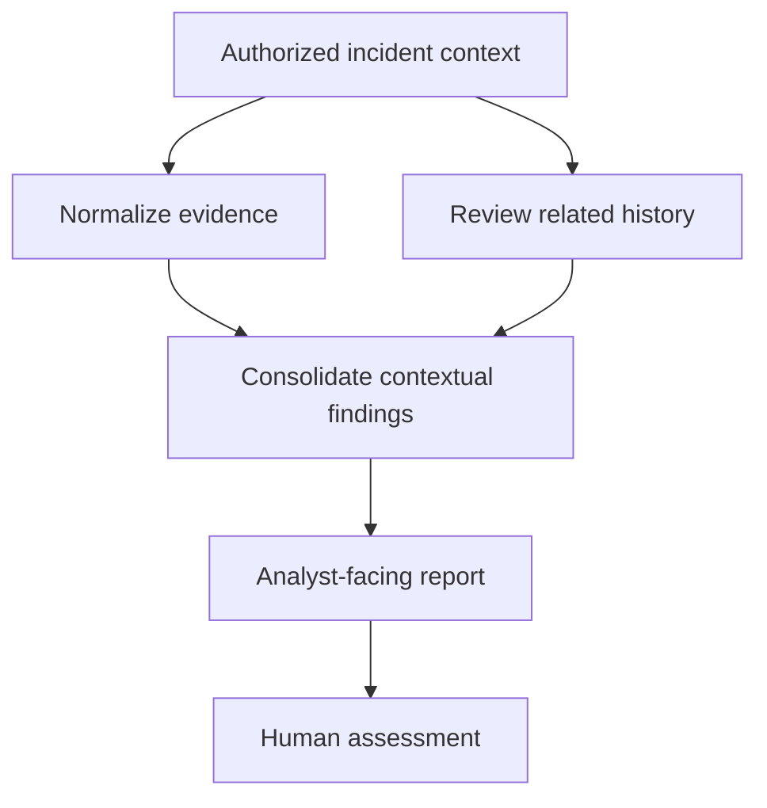

# SOC CORE — SOAR Investigation Engineering (V1–V5)

**Scope:** sanitized public summary of controlled engineering validation; no customer-specific details or production deployment information.

## Objective

Explore a modular Security Orchestration, Automation and Response (SOAR) investigation model to support evidence enrichment, contextual correlation and analyst review. Investigation reports are advisory; operational security actions require independent authorization and controls.

## Engineering phases

| Phase | Capability demonstrated |
| --- | --- |
| V1 | Structured, descriptive incident reporting |
| V2 | Reuse of approved classification logic with validation boundaries |
| V3 | Normalization of evidence fields and preservation of source context |
| V4 | Historical correlation with explicit uncertainty |
| V5 | Unified evidence summary for analyst review |

## Conceptual workflow

## Lessons from controlled validation

- Approved activity and ambiguous detections should not be treated identically.
- Related security events can be useful context without establishing causation or successful exploitation.
- Time fields and grouped counts require careful interpretation.
- Analyst review is mandatory whenever evidence is insufficient.
- Investigation and enforcement should remain independently governed and auditable.

## Publication boundary

No production source, runtime state, internal trigger, detailed timing, customer identity, incident identifier, internal network address or operational configuration is published here.

Further engineering focuses on evidence provenance, safe integration patterns, deterministic reporting and robust validation.
