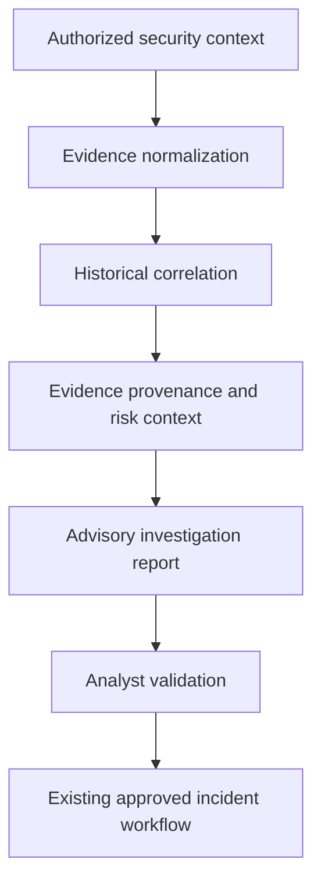

# SOC CORE — SOAR Investigation Engineering (V1–V9)

[Português (Brasil)](soar-investigation-v1-v9.pt-BR.md)

**Scope:** public, sanitized engineering overview. Operational schedules, internal policy thresholds, deployment configuration and live integration status are intentionally excluded.

## Purpose

Develop a modular, **advisory** investigation layer that helps analysts understand security events through evidence extraction, contextual enrichment and historical correlation. It is designed to complement existing detection, incident-management and response controls, not replace analyst judgement.

## Engineering evolution

| Phase | Engineering focus | Public validation scope |
| --- | --- | --- |
| V1 | Structured reporting for an incident | Descriptive output validated in a controlled test |
| V2 | Reuse of authorized classification logic | Classification behavior reviewed against representative cases |
| V3 | Extraction and normalization of security context | Evidence completeness assessed |
| V4 | Historical context and related-event search | Correlation treated as a hypothesis requiring confirmation |
| V5 | Consolidation of evidence into one reviewable report | Report structure and analyst-facing output assessed |
| V6 | Preservation of evidence provenance and advisory recommendations | Recommendation consistency tested |
| V7 | Controlled processing and duplicate-awareness | Reliability assessed through bounded tests |
| V8 | Resource-aware orchestration patterns | Operational safety and isolation evaluated |
| V9 | Complementary reporting integration pattern | Integration boundaries and failure handling reviewed |

This table describes **engineering work and controlled validation only**. It must not be interpreted as proof that any component is active, enabled or end-to-end verified in a production environment.

## Conceptual investigation model

## Validation principles

- Classifier outcomes must preserve their justification and source.
- Signature matches and temporal correlations are not proof of compromise or benign activity.
- Grouped event counts must not be described as distinct confirmed attacks.
- Missing context, unsupported detections and ambiguous outcomes require human review.
- Automated containment and incident actions remain subject to separate authorization, deterministic controls and auditable policy.
- Experimental components must not interfere with existing production security functions.

## Public disclosure boundary

This overview omits production triggers, implementation paths, detailed scheduling, deployment status, thresholds, report payloads, real case identifiers, network addressing, credentials and customer-specific information.

## Next steps

Continue evaluating advisory reporting quality, evidence traceability, controlled integration and safe failure handling before any production claims or changes to enforcement policy.
