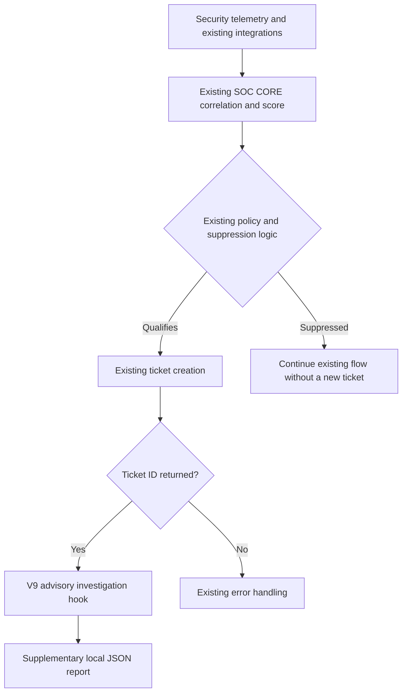

# SOC CORE — SOAR Investigation Engineering (V1–V9)

[Português (Brasil)](soar-investigation-v1-v9.pt-BR.md)

**Last validated:** October 19, 2026  
**Status:** V6/V7 validated; V8 scheduled execution validated then intentionally disabled; V9 post-ticket integration installed and structurally validated, awaiting a real qualifying event.

## Purpose

Enhance the existing SOC CORE detection, scoring, correlation, suppression and incident-management pipeline with **supplemental, advisory investigation**. The SOAR investigation layer does not replace SIEM/EDR investigation consoles, create a parallel incident queue or independently submit tickets.

## Evolution and evidence

| Iteration | Capability | Observed status |
| --- | --- | --- |
| V1 | Read an existing incident and generate descriptive JSON | Tested |
| V2 | Reuse an approved event classifier | Tested |
| V3 | Extract network context and preserve grouped-event counts | Tested |
| Correlation V4 | Search for related historical detections and potential scanner context | Tested; hypotheses require validation |
| V5 | Consolidate V3 and V4 results | Tested |
| V6 | Preserve approved classifications and give advisory recommendations | Two distinct historical cases tested |
| V7 | Batch up to two pending incidents with local deduplication state | Manual batch and follow-up dry-run tested |
| V8 | Run V7 via a resource-restricted systemd service and 15-minute timer | Manual service run and first scheduled run succeeded; timer later **disabled** |
| V9 | Produce complementary JSON analysis after the **existing** ticket-creation path returns a ticket ID | Manual analysis tested; post-ticket hook added and import tested; **no post-ticket live invocation confirmed** |

## Intended flow

This is an **intended functional path**, not confirmation of the hook's first production invocation.

## Operational details

- The existing scoring, suppression and ticket-opening logic is authoritative; SOAR does not duplicate it.
- The V9 hook is located after the existing ticket ID check. Module import, function signature, installation syntax and application restart were verified.
- The application service restarted cleanly and its API initialized; no subsequent qualifying event appeared in the observed journal window, so **automatic V9 execution is still unverified**.
- V8 processing is deliberately disabled to avoid investigating unrelated database records in a parallel workflow.
- Investigation recommendations are advisory. No additional automatic isolation, IP blocking or ticket creation was enabled by V9.
- Existing Active Response, scan scheduling and other operational workflows remain outside the scope of this work.

## Safety and limitations

Approved event classifications may suppress recommendations for known legitimate activity; unverified IDS signatures still require human assessment. Related alerts and temporal overlap with authorized scans do not prove either compromise or benignness. Grouped counts must not be treated as distinct attacks.

The live source code, internal infrastructure details, real incident identifiers, private addresses, ticket references, credentials and report contents are intentionally excluded from this public document.

## Next validation

Observe an organically occurring, qualifying ticket and confirm that the post-ticket V9 hook creates a supplementary report without changing ticket creation, containment or the original incident pipeline. Only then mark the integration operational.
