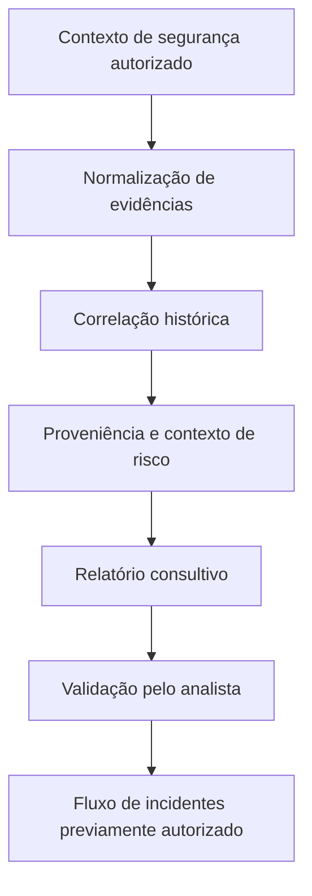

# SOC CORE — Engenharia de Investigação SOAR (V1–V9)

[English](soar-investigation-v1-v9.md)

**Escopo:** visão pública e sanitizada de engenharia. Agendamentos operacionais, limiares de política, configurações de implantação e estado das integrações em produção não são divulgados.

## Objetivo

Desenvolver uma camada modular de investigação **consultiva**, apoiando analistas na interpretação de eventos de segurança por meio de extração de evidências, enriquecimento contextual e correlação histórica. Essa camada complementa a detecção, a gestão de incidentes e os controles de resposta existentes, sem substituir a análise humana.

## Evolução da engenharia

| Fase | Foco técnico | Escopo da validação pública |
| --- | --- | --- |
| V1 | Relatórios estruturados de incidentes | Saída descritiva validada em teste controlado |
| V2 | Reaproveitamento de classificação autorizada | Comportamento analisado em cenários representativos |
| V3 | Extração e normalização de contexto de segurança | Completude das evidências avaliada |
| V4 | Contexto histórico e busca de eventos relacionados | Correlação tratada como hipótese a confirmar |
| V5 | Consolidação de evidências em relatório único | Estrutura e legibilidade avaliadas |
| V6 | Preservação da proveniência e recomendações consultivas | Consistência das recomendações testada |
| V7 | Processamento controlado e prevenção de duplicidade | Confiabilidade avaliada em testes delimitados |
| V8 | Padrões de orquestração com controle de recursos | Segurança operacional e isolamento avaliados |
| V9 | Padrão de integração para relatórios complementares | Limites de integração e tratamento de falhas revisados |

A tabela descreve **trabalho de engenharia e validações controladas**, sem comprovar que os componentes estejam ativos, habilitados ou homologados integralmente em produção.

## Modelo conceitual de investigação

## Princípios de validação

- Classificações devem preservar justificativa e fonte.
- Assinaturas e correlações temporais não comprovam comprometimento nem benignidade.
- Contagens agrupadas não representam necessariamente ataques distintos.
- Contexto incompleto, detecções não suportadas e resultados ambíguos exigem revisão humana.
- Contenção automática e ações sobre incidentes dependem de autorização, controles determinísticos e políticas auditáveis.
- Componentes experimentais não devem afetar funções existentes de segurança em produção.

## Limites da divulgação pública

Não são publicados gatilhos operacionais, caminhos de implementação, agendamentos detalhados, estado de implantação, limiares de decisão, conteúdo de relatórios, identificadores reais, endereçamento, credenciais ou dados de clientes.

## Próximas etapas

Continuar avaliando qualidade dos relatórios consultivos, rastreabilidade das evidências, integração controlada e tratamento seguro de falhas antes de novas afirmações sobre produção ou mudanças nas políticas de aplicação.
