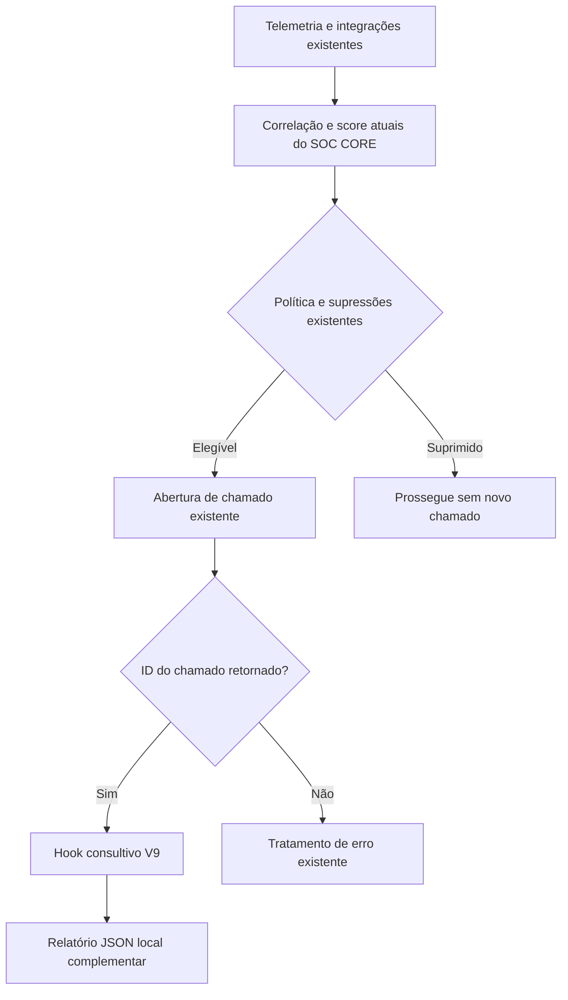

# SOC CORE — Engenharia de Investigação SOAR (V1–V9)

[English](soar-investigation-v1-v9.md)

**Última validação:** 19 de outubro de 2026  
**Situação:** V6/V7 validadas; execução agendada da V8 validada e depois desativada por decisão operacional; integração V9 instalada e validada estruturalmente, aguardando acionamento real.

## Objetivo

Aprimorar o fluxo já existente de detecção, score, correlação, supressão e abertura de chamados do SOC CORE com **investigação complementar consultiva**. O SOAR não substitui os consoles de SIEM/EDR, não cria uma fila paralela de incidentes e não reabre chamados.

## Evolução e evidências

| Versão | Capacidade | Estado observado |
| --- | --- | --- |
| V1 | Consultar incidente existente e gerar JSON descritivo | Testada |
| V2 | Reaproveitar classificador de eventos homologado | Testada |
| V3 | Extrair contexto de rede e preservar contagem de eventos agrupados | Testada |
| Correlação V4 | Encontrar detecções históricas relacionadas e possível contexto de scanner | Testada; hipóteses precisam de validação |
| V5 | Unificar resultados da V3 e V4 | Testada |
| V6 | Preservar classificações homologadas e recomendar ações consultivas | Dois cenários históricos testados |
| V7 | Processar até dois incidentes pendentes por lote, com controle local de duplicidade | Lote manual e novo dry-run testados |
| V8 | Executar V7 por serviço systemd limitado em recursos e timer de 15 minutos | Execução manual do serviço e primeira execução agendada aprovadas; timer posteriormente **desativado** |
| V9 | Gerar análise JSON complementar após o fluxo **existente** retornar ID de chamado | Análise manual testada; hook instalado e importação validada; **acionamento real pós-chamado ainda não confirmado** |

## Fluxo previsto

O diagrama representa o **funcionamento pretendido**, não a confirmação do primeiro acionamento em produção.

## Situação operacional

- As regras atuais de score, supressão e abertura de chamados continuam sendo a autoridade para selecionar incidentes.
- O hook V9 foi inserido após a verificação do identificador do chamado. Foram validados importação, assinatura da função, sintaxe e reinício da aplicação.
- O serviço principal reiniciou normalmente e a API inicializou. Na janela de logs analisada não houve novo evento elegível; portanto, **a execução automática da V9 continua não comprovada**.
- A V8 permanece desativada para evitar uma investigação paralela de registros sem relação com os critérios operacionais.
- As recomendações são consultivas. A V9 não habilitou bloqueios de IP, isolamento de dispositivos ou abertura adicional de chamados.
- Active Response, agendamentos de scanners e demais fluxos operacionais estão fora do escopo destas alterações.

## Cuidados e limitações

Classificações homologadas ajudam a reconhecer atividades legítimas, enquanto assinaturas IDS não confirmadas exigem análise humana. Correlação temporal com varreduras autorizadas não comprova que um alerta seja benigno ou que tenha ocorrido comprometimento. Contagens de eventos agrupados não representam necessariamente ataques distintos.

Esta documentação pública não divulga código de produção, endereços privados, incidentes identificáveis, números de chamados, credenciais, topologia interna ou conteúdo de relatórios.

## Próxima homologação

Acompanhar a criação natural de um chamado elegível e confirmar que o hook V9 gera um relatório complementar sem afetar abertura de chamados, contenção ou o processamento original. Somente depois dessa validação a integração deverá ser considerada operacional.
